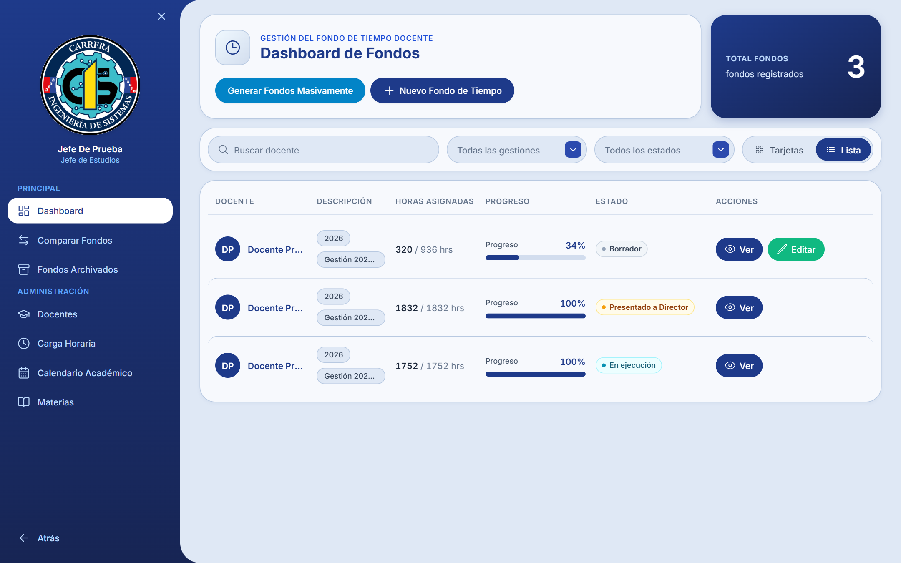
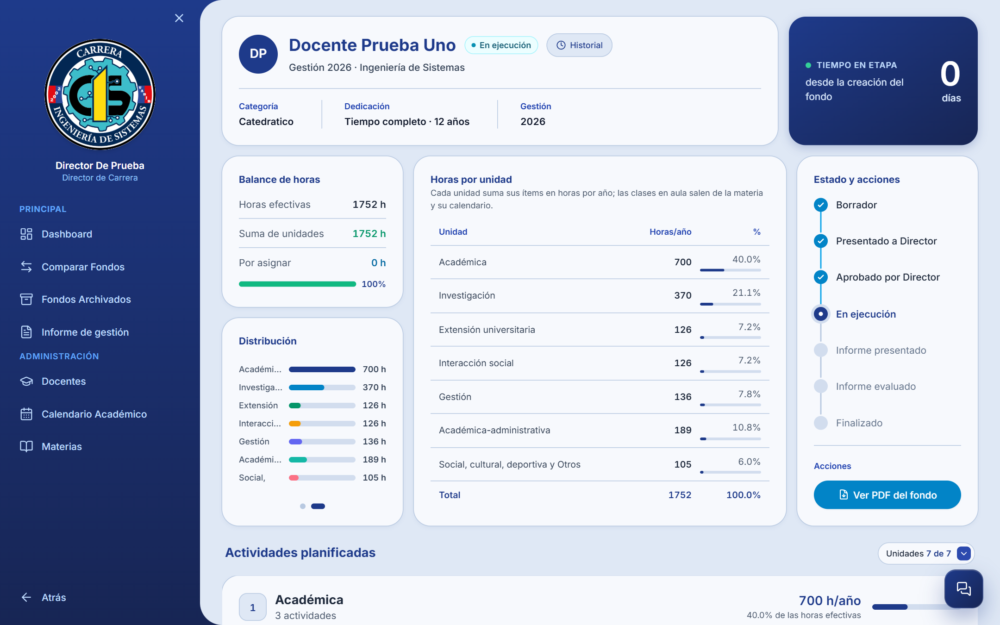
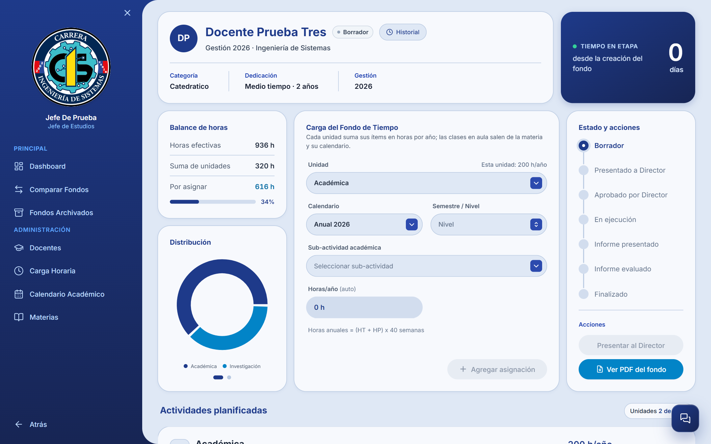
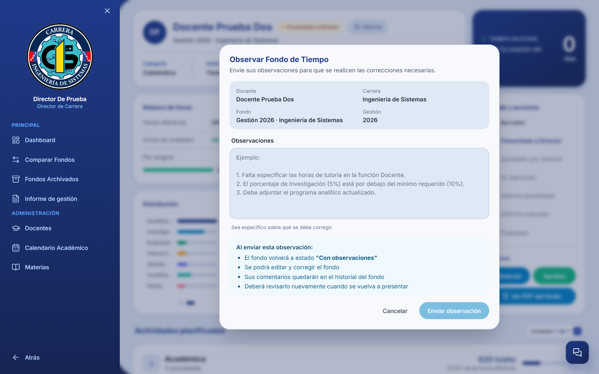
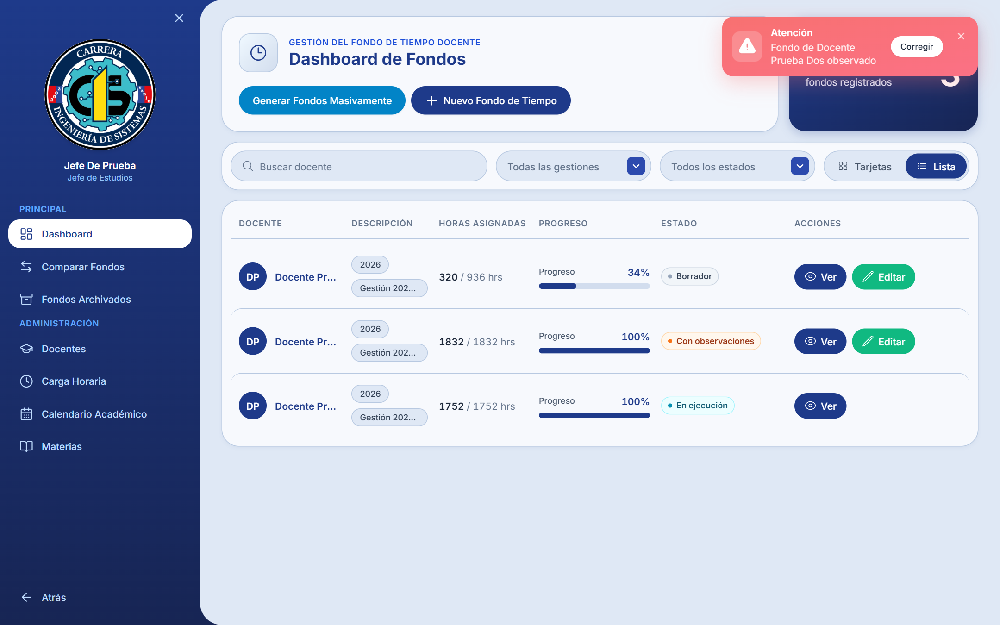
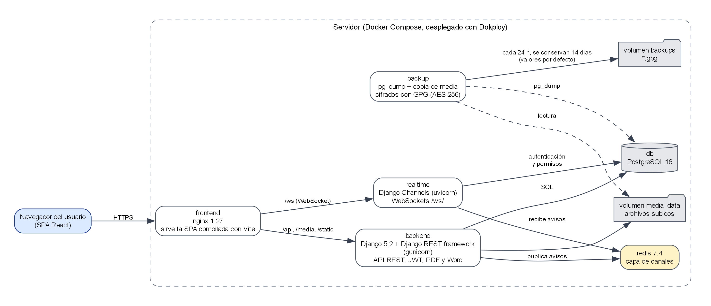
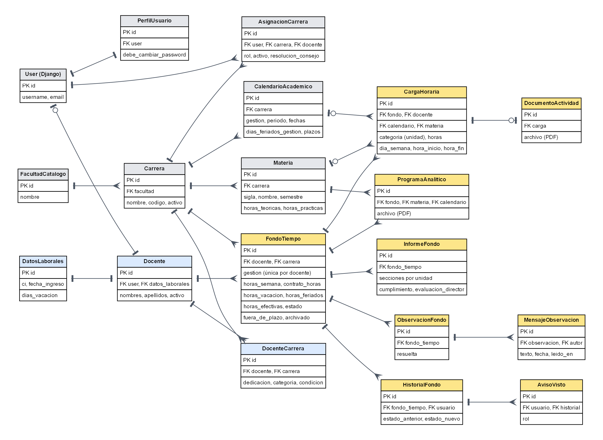

# Faculty Time-Allocation System

**Sistema de Fondo de Tiempo Docente** — a web system for Universidad Autónoma del Beni "José Ballivián" (Trinidad, Bolivia) that computes each lecturer's yearly working hours and runs the review and approval workflow defined by university regulation RR 14-A/2017.

Built as my undergraduate thesis project in Systems Engineering (2025–2026). Deployed with Docker on the program's server.



> All screenshots use fictitious test data.

## The problem

Each lecturer's yearly "time fund" (how their contract hours split into teaching, research, outreach and other units) was prepared in spreadsheets with no common rule. Reviewing the 2023–2025 funds showed that the same 2,080-hour contract produced 1,712, 1,832 or 1,880 effective hours, with gaps of up to 168 hours between lecturers entitled to the same vacation. No spreadsheet computed vacation from seniority or checked the totals, and reviews were not recorded.

## What the system does

- **One calculation rule for everyone**: contract hours minus vacation (15, 20 or 30 days by seniority) and holidays of the academic year. A fund can only be submitted when its workload adds up exactly to the effective hours.
- **Approval workflow by role**: the Head of Studies prepares and submits the fund; the Program Director reviews it, sends it back with comments or approves it, and later evaluates the lecturer's compliance report. Only the transitions the regulation allows are possible, and nobody can review their own fund.
- **Full audit trail**: every change is recorded with its author and date.
- **Real-time notices and review chat** between the lecturer, the reviewer and the Head of Studies.
- **Official documents**: the fund (PDF), the compliance report (PDF and Word) and the program's management report (PDF).
- **Archived funds and year-to-year comparison**, read-only access for the research institute, and per-program data isolation.

| Fund detail | Workload |
|---|---|
|  |  |
| **Review with comments** | **Real-time notice** |
|  |  |

## Architecture



| Layer | Technology |
|---|---|
| Backend | Python 3.12, Django 5.2, Django REST Framework, SimpleJWT, django-simple-history |
| Real time | Django Channels over WebSockets (Uvicorn), Redis 7.4 as channel layer |
| Database | PostgreSQL 16 |
| Documents | ReportLab (PDF), python-docx (Word) |
| Frontend | React 19, React Router 7, Vite, Tailwind CSS, Framer Motion, Recharts |
| Infrastructure | Docker Compose, Nginx, Gunicorn, Dokploy; daily `pg_dump` backups encrypted with GPG |

Data model (18 models in `backend/fondos/models.py`):



## Engineering highlights

- **Permissions per program and per active role** (superuser, Program Director, Head of Studies, lecturer, research institute). A user can hold several roles and works with one at a time; the API enforces every rule and the UI only hides what the user cannot do.
- **State machine for the fund** (draft → submitted → approved → in progress → report submitted → report evaluated → finished), with every transition validated on the server and stored in the history.
- **Inactive programs are read-only for everyone**, including the superuser, enforced in one place for all write endpoints.
- **Signed URLs for uploaded files**, so documents are never publicly reachable.

## Tests

- **341 backend tests** (Django test framework on PostgreSQL) covering the calculation rules, every workflow transition, permissions per role and program, the audit trail and the generated PDF and Word files.
- **21 frontend tests** (Node.js test runner).
- End-to-end checks of the main flows with Playwright during development.

```bash
# Backend (inside the backend container)
pip install -r requirements-dev.txt
python manage.py test

# Frontend
cd frontend && npm ci && node --test tests/*.test.js
```

## Running it locally

Requirements: Docker Desktop.

```bash
cp .env.example .env          # fill in the secrets (see the comments in the file)
docker compose -f docker-compose.dev.yml up -d --build
docker compose -f docker-compose.dev.yml exec backend python manage.py createsuperuser
```

- Frontend: http://localhost:5173
- API: http://localhost:8000/api/

Production uses `docker-compose.yml`: Nginx serves the built SPA and proxies `/api`, `/ws` and `/media`.

## Project structure

```
backend/
  config/        Django settings, URLs, ASGI/WSGI, signed media
  fondos/        models, API views, serializers, permissions, PDF/Word generation, tests
frontend/
  src/           React app (pages, components, API clients, real-time hooks)
  tests/         frontend unit tests
backup/          encrypted backup service
docs/screenshots/
```

## Author

**Denilson Tamacoina Vaca** — Full Stack Developer (Python/Django · React · PostgreSQL)

- LinkedIn: [denilson-tamacoina-vaca](https://www.linkedin.com/in/denilson-tamacoina-vaca-30b3a4451/)
- Email: denytva3@gmail.com

This repository started inside a shared university repository; this copy contains only the time-allocation system. The first two commits, which set up the original repository, were made by another contributor.
